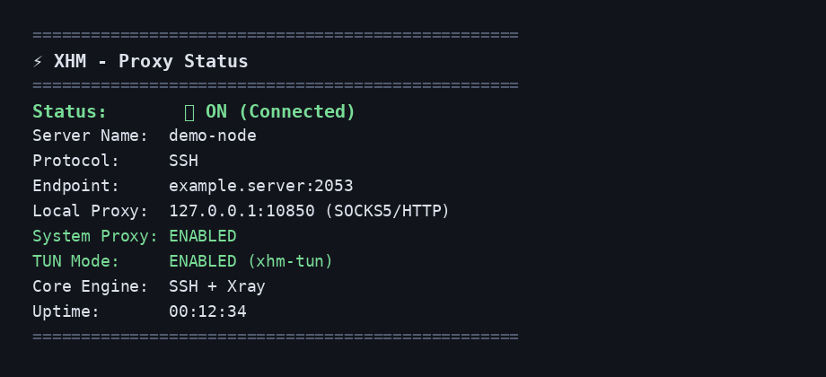

<p align="center">
  
</p>

<h1 align="center">XHM</h1>

<p align="center">
  <strong>Modern Linux Proxy &amp; VPN Manager</strong><br>
  <em>مدیریت مدرن پروکسی و VPN برای لینوکس</em>
</p>

<p align="center">
  GUI · Terminal UI · System Proxy · Full-System TUN (<code>xhm-tun</code>)<br>
  VLESS · VMess · Trojan · Shadowsocks · SOCKS · SSH
</p>

<p align="center">
  <a href="#english">English</a> ·
  <a href="#فارسی">فارسی</a>
</p>

---

<p align="center">
  
</p>

<p align="center">
  
</p>

---

<a id="english"></a>
## English

### What is XHM?
XHM is a modern Linux proxy client with a desktop GUI and a terminal UI.  
Connect to your servers, enable system proxy, or route **all system traffic** through built-in **TUN Mode** (`xhm-tun`) powered by `sing-box`.

### Features
- **Multi-protocol:** VLESS, VMess, Trojan, Shadowsocks, SOCKS, SSH (`ssh://`, `npvt-ssh://`)
- **Desktop GUI** (`xhm-gui`) and **Terminal UI / CLI** (`xhm`)
- **GNOME system proxy** with sensible bypasses for LAN / localhost
- **Full-system TUN Mode** (`xhm-tun`) — passwordless after install
- **Live traffic** speeds + totals, ping tests, analytics, subscriptions, QR share

### Requirements
Ubuntu/Debian, Fedora, Arch, or openSUSE.  
`./install.sh` installs dependencies automatically (Python 3.8+, `curl`, `xray`, `sing-box`, …).

### Install
```bash
git clone https://github.com/Man30ur/xhm.git
cd xhm
./install.sh
```

By default the installer:
- grants `cap_net_admin` to `sing-box` (passwordless TUN)
- installs a polkit rule for TUN DNS via `systemd-resolved`

Optional flags:
```bash
./install.sh --no-grant-tun-cap   # skip passwordless TUN setup
./install.sh --no-deps            # copy app files only
```

### Usage
```bash
xhm-gui    # Desktop GUI
xhm        # Terminal UI / interactive menu
xhm status
xhm tun on
xhm tun off
```

### Notes
- Connect to a server in XHM **before** enabling TUN Mode.
- Your private configs (`custom_configs.json`, subscriptions, passwords) stay local and are gitignored.

---

<a id="فارسی"></a>
## فارسی

### XHM چیست؟
یک کلاینت مدرن پروکسی برای لینوکس با **رابط گرافیکی** و **ترمینال**.  
به سرورها وصل شو، System Proxy را روشن کن، یا کل ترافیک سیستم را با **حالت TUN** (`xhm-tun`) از مسیر پروکسی رد کن.

### امکانات
- پشتیبانی از **VLESS / VMess / Trojan / Shadowsocks / SOCKS / SSH**
- GUI دسکتاپ (`xhm-gui`) و منوی ترمینال (`xhm`)
- پروکسی سیستم GNOME
- **TUN سراسری** (`xhm-tun`) — بعد از نصب بدون پسورد تکراری
- سرعت لحظه‌ای، پینگ، آنالیتیکس، سابسکریپشن، QR

### نصب
```bash
git clone https://github.com/Man30ur/xhm.git
cd xhm
./install.sh
```

به‌صورت پیش‌فرض:
- دسترسی `cap_net_admin` به `sing-box` داده می‌شود
- قانون polkit برای DNS حالت TUN نصب می‌شود

### استفاده
```bash
xhm-gui      # رابط گرافیکی
xhm          # منوی ترمینال
xhm status
xhm tun on
xhm tun off
```

### نکته
اول به یک سرور وصل شو، بعد TUN را روشن کن.  
فایل‌های شخصی کانفیگ داخل گیت نمی‌روند.

---

## License
Use freely for personal projects. Contributions welcome via Pull Request.
